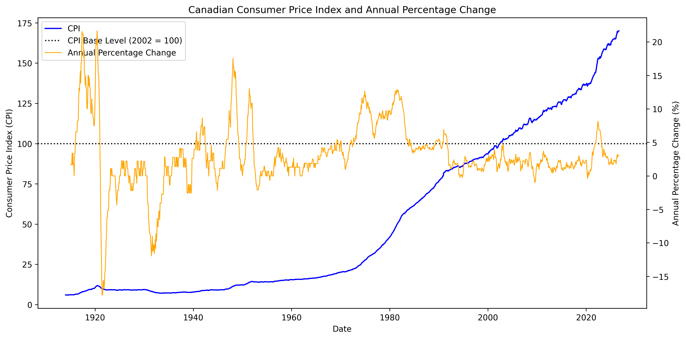

# FINE3300-2026-A2

FINE 3300 Assignment 2 - Canadian Consumer Price Index Analysis and Inflation Calculator

## Project Overview

This project uses Python to analyze Canada's Consumer Price Index (CPI) and examine changes in the cost of living over time.

The project has two main components:

1. **CPI Analysis:** Uses Pandas, NumPy, and Matplotlib to examine historical Canadian CPI data, calculate annual percentage changes, and visualize CPI trends over time.
2. **Inflation Calculator:** An enhanced version of the Bank of Canada's inflation calculator that allows users to calculate the inflation-adjusted value of an amount between two selected months.

## Project Structure

The project is organized into the following files and folders:

| File / Folder | Description |
|---|---|
| `data/` | Contains the original Canadian CPI dataset. |
| `output/` | Stores the generated CPI graph. |
| `cpi_analysis.ipynb` | Jupyter Notebook containing the CPI data analysis and visualization. |
| `inflation_calculator.py` | Python program that calculates inflation-adjusted prices and rates of change. |
| `requirements.txt` | Lists the Python libraries required to run the project. |
| `README.md` | Provides project information and instructions. |

## Technologies Used

- **Python** – Main programming language.
- **Pandas** – Reads, organizes, and processes CPI data.
- **NumPy** – Performs numerical calculations, including annualized inflation rates.
- **Matplotlib** – Creates the CPI time-series graph.

## Installation and Setup

### 1. Clone the Repository

Download the project from GitHub or clone it using:

```bash
git clone https://github.com/AndraParkerr/FINE3300-2026-A2.git
cd FINE3300-2026-A2
```

### 2. Create and Activate a Virtual Environment

For macOS:

```bash
python3 -m venv .venv
source .venv/bin/activate
```

### 3. Install Required Libraries

```bash
pip install -r requirements.txt
```

## Running the Programs

### CPI Analysis

1. Open `cpi_analysis.ipynb` in Visual Studio Code.
2. Select the project's Python virtual environment as the notebook kernel.
3. Run all notebook cells to load the CPI dataset, calculate annual percentage changes, and generate the graph.

The resulting graph is saved in the `output/` folder.

### Inflation Calculator

Run the following command in the terminal:

```bash
python3 inflation_calculator.py
```

Follow the prompts to enter:
- An original price in Canadian dollars (CAD).
- A first month in `YYYY-MM` format.
- A second month in `YYYY-MM` format.

The program calculates and displays the inflation-adjusted price, percentage change, number of years, annualized rate of change, and CPI values for both selected months.


## CPI Analysis and Graph

The CPI graph illustrates changes in Canada's Consumer Price Index from January 1914 to September 2026.

The graph includes:
- **CPI:** The historical Canadian Consumer Price Index, displayed on the left vertical axis.
- **Annual Percentage Change:** The year-over-year percentage change in CPI, displayed on the right vertical axis.
- **Base Level:** A dotted horizontal reference line at 100, representing the 2002 CPI base level (2002 = 100).

### Graph

### Graph



### Interpretation

The graph illustrates the long-term increase in Canada's overall price level over the period examined. The annual percentage change fluctuates over time, reflecting periods of higher and lower inflation. While the CPI shows the cumulative change in the price level, the annual percentage change highlights how quickly prices have changed compared with the same month in the previous year.


## Sample Inflation Calculator Output

The following example demonstrates the calculator using an original price of $100.00 CAD between January 2000 and January 2020.

```text
CANADIAN INFLATION CALCULATOR
--------------------------------
Enter the original price (CAD): $100
Enter the first date (YYYY-MM): 2000-01
Enter the second date (YYYY-MM): 2020-01

========== INFLATION CALCULATOR RESULTS ==========
Original price:             $100.00 CAD
Adjusted price:             $146.31 CAD
Percentage change:          46.31%
Number of years:            20.00
Annual rate of change:      1.92%
CPI for 2000-01:             93.50
CPI for 2020-01:             136.80

Interpretation: The overall CPI price level increased over the selected period.
==================================================
```

In this example, an original price of $100.00 in January 2000 is equivalent to approximately $146.31 in January 2020, reflecting a 46.31% increase in the CPI over the 20-year period.
